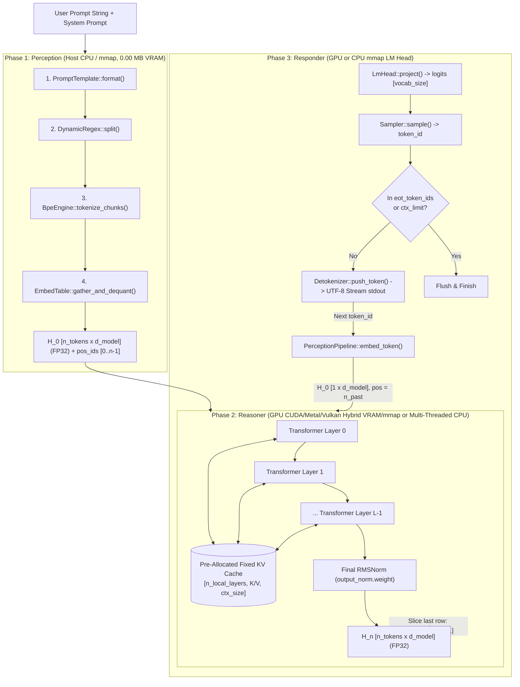

# OpenGP Developer & Architecture Guide

> **A Self-Contained, Modular, Distributed-Ready C++ LLM Inference Engine Built on Vendored GGML/GGUF**

---

## Table of Contents

1. [Part 1: End-to-End LLM Inference Flow](#part-1-end-to-end-llm-inference-flow)
   - [1.1 High-Level Three-Phase Flow](#11-high-level-three-phase-flow)
   - [1.2 Prefill vs. Autoregressive Decode](#12-prefill-vs-autoregressive-decode)
   - [1.3 Phase 1 — Perception (Text → H₀)](#13-phase-1--perception-text--h₀)
   - [1.4 Phase 2 — Reasoner (H₀ → Hₙ)](#14-phase-2--reasoner-h₀--hₙ)
   - [1.5 Phase 3 — Responder (Hₙ → Streaming UTF-8 Tokens)](#15-phase-3--responder-hₙ--streaming-utf-8-tokens)
2. [Part 2: OpenGP Codebase & System Architecture](#part-2-opengp-codebase--system-architecture)
   - [2.1 Core Architectural Principles](#21-core-architectural-principles)
   - [2.2 Repository Directory Structure](#22-repository-directory-structure)
   - [2.3 Phase 1 Module Reference (`opengp::perception`)](#23-phase-1-module-reference-opengpperception)
   - [2.4 Phase 2 Module Reference (`opengp::reasoner`)](#24-phase-2-module-reference-opengpreasoner)
   - [2.5 Phase 3 Module Reference (`opengp::responder`)](#25-phase-3-module-reference-opengpresponder)
   - [2.6 Memory Architecture (VRAM & Host RAM)](#26-memory-architecture-vram--host-ram)
   - [2.7 Distributed Volunteer Layer-Slice Design](#27-distributed-volunteer-layer-slice-design)
   - [2.8 Build System & Developer Workflows](#28-build-system--developer-workflows)
   - [2.9 CLI Tools, Flags & Observed Benchmarks](#29-cli-tools-flags--observed-benchmarks)
   - [2.10 Architectural Boundaries & Roadmap](#210-architectural-boundaries--roadmap)

---

# Part 1: End-to-End LLM Inference Flow

OpenGP decomposes Large Language Model inference into three clean, loosely coupled phases named as nouns: **`perception` → `reasoner` → `responder`**.

## 1.1 High-Level Three-Phase Flow



### Data Contract Across Phase Boundaries

| Boundary | Exact Payload | Shape / Type | Purpose |
| :--- | :--- | :--- | :--- |
| **Phase 1 → Phase 2** | `PerceptionOutput::H_0`, `pos_ids` | `[n_tokens, d_model]` (`F32`), `[n_tokens]` (`I32`) | Continuous initial token embeddings and sequence coordinates for deferred RoPE. |
| **Phase 2 Layer → Layer** | Ping-pong residual buffers `H_curr`, `H_next` | `[n_tokens, d_model]` (`F32`) | Residual highway carried across Transformer blocks `0 .. L - 1`. |
| **Phase 2 → Phase 3** | Last row of `ReasoningOutput::H_L` (`H_n`) | `[1, d_model]` (`F32`) | Contextualized thought vector of the latest token after reading all causal context. |
| **Phase 3 → Phase 1 (Decode)** | Single generated `token_id` | `int32_t` scalar | Looked up via `PerceptionPipeline::embed_token()` to produce `[1, d_model]` for the next step. |

---

## 1.2 Prefill vs. Autoregressive Decode

Every generation turn consists of two distinct execution regimes that run through the **exact same** `Reasoner` computation graph:

1. **Prefill (Runs once per prompt, `n_tokens = N`):**
   - Processes all `N` formatted prompt tokens simultaneously as matrices (`[N x d_model]`).
   - Uses an upper-triangular causal mask (`kq_mask[j, i] = -INFINITY` for `j > n_past + i`) so token `i` attends only to tokens `0 .. n_past + i`.
   - Populates `K` and `V` rows `0 .. N - 1` inside every layer's KV Cache.
   - Only the **last row** `H_n[N - 1]` is sent to Phase 3 `LmHead` to predict token `N + 1`, because row `N - 1` is the only token that has attended to the entire prompt.

2. **Autoregressive Decode (Repeats per generated token, `n_tokens = 1`):**
   - Embeds the single newly sampled token (`embed_token(next_id)`) at `pos_id = n_past`.
   - Appends 1 `K` row and 1 `V` row per layer at offset `n_past`.
   - Computes attention of the 1 new Query vector against all `0 .. n_past` historical Keys and Values stored in the KV Cache (`kq_mask` is all `0.0f`).
   - Outputs `H_n` of shape `[1 x d_model]`, which is immediately projected to logits to pick the next token until an EOT token, `--max-tokens`, or `ctx_size` limit is reached.

---

## 1.3 Phase 1 — Perception (Text → `H_0`)

1. **Prompt Templating (`PromptTemplate`):** Wraps `user_prompt` and optional `system_prompt` according to metadata (e.g., LLaMA-3 `<|begin_of_text|><|start_header_id|>user<|end_header_id|>...`, Qwen/ChatML `<|im_start|>user\n...`, or raw completion for base models without a `chat_template`).
2. **Dynamic Pre-Tokenization (`DynamicRegex`):** Splits formatted text into semantic chunks (`words`, numbers, punctuation, special control headers) selected dynamically from `tokenizer.ggml.pre` (`llama3`, `qwen2`, etc.).
3. **BPE Tournament (`BpeEngine`):** Runs an $O(M \log M)$ min-heap + doubly-linked list merge tournament per chunk using `tokenizer.ggml.merges` and `tokenizer.ggml.tokens`. Every `BpeCandidate` validates `left->token_id == top.left_id` and `right->token_id == top.right_id` with left-to-right tie-breaking so stale heap entries never corrupt adjacent nodes.
4. **Zero-VRAM Embedding Assembly (`EmbedTable`):** Memory-maps `token_embd.weight` via `mmap(PROT_READ)` directly in Host RAM (**0.00 MB VRAM**), gathers only the requested token rows in $O(1)$ pointer arithmetic, dequantizes quantized blocks (`Q6_K`, `Q8_0`, `F16`, etc.) to `FP32` via GGML traits, and applies optional architecture scaling (`sqrt(d_model)` for Gemma).

---

## 1.4 Phase 2 — Reasoner (`H_0` → `H_n`)

For each layer `l` in `[layer_range.start .. layer_range.end)`, `build_layer_graph()` constructs a GGML computation graph over `H_in [d_model, n_tokens]`:

```mermaid
flowchart LR
    HIN["H_in [d_model, n_tokens]"] --> RMS1["Pre-Attn RMSNorm\n(attn_norm.weight)"]
    RMS1 --> WQ["Wq Projection -> Q"]
    RMS1 --> WK["Wk Projection -> K"]
    RMS1 --> WV["Wv Projection -> V (Unrotated Payload)"]

    WQ --> QSL["Reshape [d_head_k, n_heads, n_tokens]\n+ Optional attn_q_norm"]
    WK --> KSL["Reshape [d_head_k, n_kv_heads, n_tokens]\n+ Optional attn_k_norm"]

    QSL --> RQ["RoPE (ggml_rope_ext)\nNORM (0) or NEOX (2) + pos_ids"]
    KSL --> RK["RoPE (ggml_rope_ext)\nNORM (0) or NEOX (2) + pos_ids"]

    RK --> KVC_W["Write K, V -> KV Cache\n@ n_past"]
    WV --> KVC_W
    KVC_W --> KVC_R["Read K_all, V_all\n[0 .. n_past + n_tokens - 1]"]

    RQ --> ATTN["GQA / MHA / MQA Scaled Dot-Product\nSoftmax((Q · K^T) / sqrt(d_k) + kq_mask) · V"]
    KVC_R --> ATTN

    ATTN --> WO["Wo Projection (attn_output.weight)"]
    HIN --> ADD1((("+")))
    WO --> ADD1

    ADD1 --> HM["H_mid"]
    HM --> RMS2["FFN RMSNorm\n(ffn_norm.weight)"]
    RMS2 --> GATE["Gate: SiLU(H · W_gate)"]
    RMS2 --> UP["Up: H · W_up"]
    GATE --> EW((("*")))
    UP --> EW
    EW --> DOWN["Down: (Gate * Up) · W_down"]
    HM --> ADD2((("+")))
    DOWN --> ADD2
    ADD2 --> HOUT["H_out [d_model, n_tokens]"]
```



Key architectural behaviors in the computation graph:
- **Unified MHA / GQA / MQA:** `K` and `V` tensors use `n_kv_heads`, while `Q` uses `n_heads`. `ggml_mul_mat` natively broadcasts `n_heads / n_kv_heads` Query heads onto each shared KV head (e.g., `32 / 8 = 4` in LLaMA-3.1 8B and Qwen3-8B; `6 / 6 = 1` in Stories 15M).
- **Optional Per-Layer Tensors Auto-Detected:** Qwen3-style `attn_q_norm.weight` / `attn_k_norm.weight`, bias tensors (`attn_q/k/v/output.bias`), and LLaMA-3.1 scaling factors (`rope_freqs.weight`) are automatically bound if present in the GGUF.
- **RoPE Applied Strictly to $Q$ and $K$:** Value vectors ($V$) are never rotated, preserving pure semantic features in the KV Cache.
- **Final Tail Normalization:** Applied (`output_norm.weight`) only on the engine owning the final layer (`end == n_layers`, unless disabled).

---

## 1.5 Phase 3 — Responder (`H_n` → Streaming UTF-8 Tokens)

1. **LM Head Projection (`LmHead`):** Computes $\text{logits} = \mathbf{h}_{\text{last}} \cdot W_{\text{head}}^T$ (`output.weight`, automatically falling back to tied `token_embd.weight`). Uses a persistent single-vector GGML graph and allocator across all decode steps.
2. **Repetition Penalty (`Sampler`):** Scans unique token IDs within the trailing `repeat_last_n` window; positive logits are divided by `repeat_penalty`, while negative logits are multiplied by `repeat_penalty`.
3. **Temperature & Truncation Filtering (`Sampler`):**
   - `temperature <= 0.0f` takes an immediate greedy `std::max_element` argmax fast-path.
   - Otherwise scales by `1 / temperature`, prunes via **Top-K**, computes numerically stable Softmax ($\exp(z - z_{\max})$), prunes via **Min-P** ($p_i \ge \text{min\_p} \cdot p_{\max}$) and **Top-P** nucleus cumulative cutoff, then draws from a seeded `std::mt19937`.
4. **Stop Detection & Streaming Detokenizer (`ResponderEngine` + `Detokenizer`):**
   - Stops immediately if `next_id` matches any control/EOS token in `TokenizerConfig::eot_token_ids` (dynamically harvested in Phase 1).
   - Otherwise reverses GPT-2 byte-to-Unicode pieces (BPE) or `▁` / `<0xHH>` hex byte-fallback tokens (SentencePiece Unigram), holding incomplete multi-byte UTF-8 prefixes in `pending_bytes_` until completed by the next token so terminal output never emits corrupted glyphs.

---

# Part 2: OpenGP Codebase & System Architecture

## 2.1 Core Architectural Principles

1. **100% Self-Contained Repository:** All GGML, GGUF, CPU SIMD (`arch/x86`, `arch/arm`), CUDA (`vendor/ggml/src/ggml-cuda`), Apple Metal (`vendor/ggml/src/ggml-metal`), and Vulkan (`vendor/ggml/src/ggml-vulkan`, including vendored `spirv.hpp`) kernels are vendored in-tree under `opengp/vendor/ggml/`. Zero external `llama.cpp` or parent-directory dependencies.
2. **Model-Agnostic Dynamic Discovery:** Zero hardcoded model names, dimensions, stop IDs, or RoPE constants. Every hyperparameter and tensor layout is driven dynamically by GGUF metadata (`general.architecture`, `<arch>.*`) and tensor lookup.
3. **Hardware Portability (GPU-First with Automatic CPU Fallback):** Runtime priority is **CUDA → Metal → Vulkan → CPU**. Automatically initializes NVIDIA CUDA (`OPENGP_HAS_CUDA=1`), Apple Metal (`OPENGP_HAS_METAL=1`), or Vulkan (`OPENGP_HAS_VULKAN=1`, for AMD/Intel dGPUs and iGPUs) when present. Vulkan runs a startup smoke test against CPU and an op-support preflight on the real layer graph, logging and seamlessly falling back to multi-threaded CPU (`ggml_backend_cpu_init`) on any driver/hardware/op failure or when `OPENGP_DISABLE_VULKAN=1` is set.
4. **Deterministic Memory Budgeting:** Allocates fixed KV Cache up front (default `512`, auto-halving on init if VRAM is tight), then pins as many Transformer layers as fit in remaining VRAM while streaming overflow layers over a single reusable GPU staging buffer from zero-copy Host `mmap`.

---

## 2.2 Repository Directory Structure

```text
opengp/
├── CMakeLists.txt                       # Builds ggml (+ optional CUDA/Metal/Vulkan) + 3 phase libs + 3 CLIs
├── Makefile                             # Developer wrapper (`make clean` preserves vendor GGML/CUDA/Vulkan)
├── README.md
├── docs/
│   └── architecture/
│       └── OPENGP_DEVELOPER_GUIDE.md    # This guide
├── models/                              # Local .gguf files (gitignored)
├── vendor/ggml/                         # In-tree GGML, GGUF, CPU SIMD, CUDA, Metal & Vulkan backends
│   ├── CMakeLists.txt
│   ├── include/                         # ggml.h, gguf.h, ggml-backend.h, ggml-cuda.h, ggml-metal.h, ggml-vulkan.h, ...
│   └── src/
│       ├── ggml.c, gguf.cpp, ggml-alloc.c, ggml-backend*.cpp, ggml-quants.c
│       ├── ggml-cpu/                    # AVX/AVX2/AVX512/NEON/AMX kernels
│       ├── ggml-cuda/                   # Vendored CUDA & FlashAttention kernels
│       ├── ggml-metal/                  # Vendored Apple Metal kernels (embedded on macOS)
│       └── ggml-vulkan/                 # Vendored Vulkan compute shaders (AMD/Intel/iGPU)
├── include/
│   ├── perception/                      # Phase 1 public headers
│   │   ├── tokenizer_config.h
│   │   ├── prompt_template.h
│   │   ├── regex_patterns.h
│   │   ├── dynamic_regex.h
│   │   ├── bpe_engine.h
│   │   ├── embed_table.h
│   │   └── perception_pipeline.h
│   ├── reasoner/                        # Phase 2 public headers
│   │   ├── backend_selector.h
│   │   ├── model_config.h
│   │   ├── weight_store.h
│   │   ├── kv_cache.h
│   │   ├── layer_graph.h
│   │   └── reasoner_engine.h
│   └── responder/                       # Phase 3 public headers
│       ├── lm_head.h
│       ├── sampler.h
│       ├── detokenizer.h
│       └── responder_engine.h
└── src/
    ├── perception/                      # Phase 1 implementation + opengp_perception CLI
    ├── reasoner/                        # Phase 2 implementation + opengp_reasoner CLI
    └── responder/                       # Phase 3 implementation + opengp_infer E2E CLI
```

---

## 2.3 Phase 1 Module Reference (`opengp::perception`)

| Class / File | Responsibility | Key Entry Points |
| :--- | :--- | :--- |
| **`TokenizerConfig`** ([tokenizer_config.h](file:///media/vithurshan/vithu/opengp/ggml/opengp/include/perception/tokenizer_config.h)) | Parses `tokenizer.ggml.*`, `chat_template`, special IDs, and harvests all `eot_token_ids` dynamically. | `parse_from_gguf(gctx)` |
| **`PromptTemplate`** ([prompt_template.h](file:///media/vithurshan/vithu/opengp/ggml/opengp/include/perception/prompt_template.h)) | Wraps prompts in LLaMA-3, ChatML/Qwen, or raw completion format based on metadata. | `PromptTemplate::format(cfg, user, sys)` |
| **`DynamicRegex`** ([dynamic_regex.h](file:///media/vithurshan/vithu/opengp/ggml/opengp/include/perception/dynamic_regex.h)) | Selects pre-tokenizer regex rules dynamically from `tokenizer.ggml.pre`. | `configure_from_pre()`, `split()` |
| **`BpeEngine`** ([bpe_engine.h](file:///media/vithurshan/vithu/opengp/ggml/opengp/include/perception/bpe_engine.h)) | Loads vocab/merges, maintains GPT-2 byte-to-Unicode tables, executes min-heap BPE merges. | `load_from_gguf()`, `tokenize_chunks()`, `id_to_token()`, `unicode_to_byte()` |
| **`EmbedTable`** ([embed_table.h](file:///media/vithurshan/vithu/opengp/ggml/opengp/include/perception/embed_table.h)) | Zero-VRAM Host `mmap` embedding lookup and row dequantization (`F32`, `Q6_K`, `Q8_0`, etc.). | `init_from_gguf()`, `gather_and_dequant()` |
| **`PerceptionPipeline`** ([perception_pipeline.h](file:///media/vithurshan/vithu/opengp/ggml/opengp/include/perception/perception_pipeline.h)) | Orchestrates full prompt tokenization (`process()`) and single-token decode lookup (`embed_token()`). | `initialize()`, `process()`, `embed_token()` |

---

## 2.4 Phase 2 Module Reference (`opengp::reasoner`)

| Class / File | Responsibility | Key Types & Methods |
| :--- | :--- | :--- |
| **`ModelConfig` & `ReasoningOptions`** ([model_config.h](file:///media/vithurshan/vithu/opengp/ggml/opengp/include/reasoner/model_config.h)) | Reads `<arch>.*` GGUF dimensions, attention ratios, RoPE base/mode (`NORM`/`NEOX`), and stores user options (`device`, `ctx_size=512`, `kv_precision`, `vram_utilization`, `layers`). | `LayerRange`, `ReasoningOptions`, `ModelConfig::load_from_gguf()` |
| **`WeightStore`** ([weight_store.h](file:///media/vithurshan/vithu/opengp/ggml/opengp/include/reasoner/weight_store.h)) | Maps GGUF tensors read-only via `mmap`, resolves `blk.<global_l>.*` only for `[range.start .. range.end)`, and manages GPU-resident + single-layer `ggml_tallocr` staging buffers. | `LayerWeights`, `WeightStore::init()`, `prepare_layer(local_l)` |
| **`KVCache`** ([kv_cache.h](file:///media/vithurshan/vithu/opengp/ggml/opengp/include/reasoner/kv_cache.h)) | Allocates fixed `k_layers_[l]` and `v_layers_[l]` (`[d_head * n_kv_heads, capacity]`) for `n_local_layers`, exposing zero-copy write/read graph views. | `init()`, `allocate(cap)`, `write_view_k/v()`, `read_view_k/v()`, `advance()`, `reset()` |
| **`LayerGraphBuilder`** ([layer_graph.h](file:///media/vithurshan/vithu/opengp/ggml/opengp/include/reasoner/layer_graph.h)) | Emits the GGML computation graph for one Transformer block (`RMSNorm -> QKV -> QK-Norm -> RoPE -> KV write -> Causal GQA/MHA -> Wo -> Res1 -> FFN RMSNorm -> SwiGLU -> Res2`), final `output_norm`, and a Vulkan-only multi-layer fused graph (`build_fused_layers_graph`) with optional `ggml_flash_attn_ext` and fused `ggml_swiglu_split`. | `build_layer_graph()`, `build_final_norm_graph()`, `build_fused_layers_graph()` |
| **`BackendSelector`** (`backend_selector.h`) | Shared GPU discovery following CUDA → Metal → Vulkan priority; skips software rasterizers (`llvmpipe`/`lavapipe`/`SwiftShader`), caches a startup Vulkan-vs-CPU numerical smoke test, runs a cached ~9 MB `Q4_K` matvec micro-benchmark for Vulkan iGPUs in `AUTO` mode (falling back to CPU unless the iGPU beats CPU by ≥10%; bypassed when `--device gpu` is explicit), and honors `OPENGP_DISABLE_VULKAN=1`. | `GpuBackendKind`, `GpuBackendSelection`, `select_gpu_backend()` |
| **`ReasoningEngine`** (`reasoner_engine.h`) | Selects GPU or CPU backend via `select_gpu_backend()`, applies shared-memory caps on Vulkan iGPUs, preflights Vulkan op support with automatic CPU re-init on failure, auto-halves `ctx_size` if memory is tight, plans `WeightStore`, reuses a single `ggml_gallocr_t`, and runs layer-by-layer execution + `ActivationPacket` handoffs. | `initialize()`, `forward()`, `forward_layer()`, `forward_packet()`, `reset_kv_cache()` |

---

## 2.5 Phase 3 Module Reference (`opengp::responder`)

| Class / File | Responsibility | Key Types & Methods |
| :--- | :--- | :--- |
| **`LmHead`** (`lm_head.h`) | Maps `output.weight` (or tied `token_embd.weight`), auto-places on GPU (CUDA/Metal/Vulkan, with a 50% shared-memory cap on Vulkan iGPUs and op-support preflight) if free memory > weight + 256 MB else CPU `mmap`, caches a persistent projection graph. | `LmHeadDevice`, `init()`, `project()` |
| **`Sampler`** ([sampler.h](file:///media/vithurshan/vithu/opengp/ggml/opengp/include/responder/sampler.h)) | Applies repetition penalty, greedy fast-path, temperature, Top-K, stable Softmax, Min-P, Top-P, and PRNG draw. | `SamplerConfig`, `configure()`, `sample()` |
| **`Detokenizer`** ([detokenizer.h](file:///media/vithurshan/vithu/opengp/ggml/opengp/include/responder/detokenizer.h)) | Streaming Byte-BPE & SentencePiece Unigram decoder with partial multi-byte UTF-8 buffering. | `init()`, `push_token()`, `flush()`, `reset()` |
| **`RespondingEngine`** ([responder_engine.h](file:///media/vithurshan/vithu/opengp/ggml/opengp/include/responder/responder_engine.h)) | Combines `LmHead`, `Sampler`, `Detokenizer`, and dynamic `eot_token_ids` checking. | `initialize()`, `sample_next()`, `is_stop_token()`, `decode_token()`, `flush()` |

---

## 2.6 Memory Architecture (VRAM & Host RAM)

OpenGP uses a **KV-First Memory Budgeting** strategy inside `ReasoningEngine::initialize()`:

1. **Before KV Allocation:** Reserves minimum non-KV headroom (`512 MB`) so at least 1 staging layer + compute scratch always fit. If `bytes_per_token * ctx_size` exceeds available budget (or `allocate()` fails), `ctx_size` is **halved by 2** (`target_ctx /= 2`) during init and logged.
2. **After KV Allocation:** Queries actual remaining free VRAM (`usable = free_vram * vram_utilization - 256 MB scratch reserve`), pins layers `0 .. R-1` permanently in `resident_buf_`, and streams remaining layers `R .. L-1` from OS `mmap` page cache into one reusable `stage_buf_`.
3. **After Reasoning Init:** `LmHead` inspects remaining free VRAM; if `free_vram > lm_head_bytes + 256 MB`, `output.weight` is placed on GPU, otherwise it stays in zero-copy Host `mmap` (`CPU mmap`).
4. **Vulkan Integrated GPUs (UMA Shared Memory):** On integrated GPUs (e.g., Intel UHD/Iris, AMD Radeon Graphics), Vulkan memory heaps reflect shared system RAM already used by the OS and `mmap` page cache. OpenGP automatically detects `GGML_BACKEND_DEVICE_TYPE_IGPU` and caps the usable GPU budget to `min(free * vram_utilization, 50% of reported free)` for both `ReasoningEngine` and `LmHead` so the system remains responsive without OOM pressure.

### Measured Memory Map (`baronllm-llama3.1-v1-q6_k.gguf` on RTX 3060 5,806 MiB VRAM)

With `--ctx-size 2048` (32 layers, GQA `32 Q / 8 KV`, `d_model = 4096`):

```text
GPU VRAM (RTX 3060 — 5,806 MiB)                        Host RAM (Zero-Copy mmap + OS Page Cache)
───────────────────────────────────────────────────    ───────────────────────────────────────────────────
• Resident Layers [blk.0 .. blk.21] :  ~3,754.4 MB     • Phase 1 token_embd.weight        :   411.0 MB
• Single-Layer Staging (stage_buf_) :     170.7 MB  ◄══• Streamed [blk.22 .. blk.31]        : ~1,707.0 MB
• Global Weights (output_norm+freqs):      0.02 MB     • Resident mmap pages (evictable)  : ~3,754.4 MB
• Fixed KV Cache (ctx=2048, F16)    :    256.00 MB     • Ping-Pong H_curr/H_next & logits :     ~1.5 MB
• Phase 3 LM Head (output.weight)   :    411.00 MB     • BPE Vocab & Merge Hash Tables    :    ~15.0 MB
• Compute Scratchpad (gallocr_)     :      2.11 MB
• CUDA Context + Free Headroom      :  ~1,211.7 MB
```

| Context Setting (`--ctx-size`) | Allocated KV Cache (`F16`) | Layer Split (Resident / Streamed) | Weight VRAM Used |
| :--- | :--- | :--- | :--- |
| **`512`** *(default)* | `64.00 MB` | **23 resident / 9 streamed** | `4,095.8 MB` / `5,461.0 MB` |
| **`2048`** | `256.00 MB` | **22 resident / 10 streamed** | `3,925.1 MB` / `5,461.0 MB` |
| **`4096`** | `512.00 MB` | **21 resident / 11 streamed** | `3,754.5 MB` / `5,461.0 MB` |
| **`16384`** *(or `65536` auto-halved)* | `2,048.00 MB` | **14 resident / 18 streamed** | `2,559.9 MB` / `5,461.0 MB` |

---

## 2.7 Distributed Volunteer Layer-Slice Design

`ReasoningEngine` is decoupled at the layer-sequence level (`LayerRange`) so future volunteer workers can host disjoint slices of a large model across machines:

- **`--layer-start <N>` / `--layer-end <N>`:** Each node maps weights (`blk.N..`), uploads GPU layers, and allocates KV Cache (`k_layers_`, `v_layers_`) **only** for its owned `range.count()` layers.
- **`--no-final-norm` (auto-controlled):** Intermediate nodes skip `output_norm.weight` (`final_norm=OFF`); only the tail node (`end == n_layers`) applies final normalization (`final_norm=ON`).
- **`forward_layer()` & `ActivationPacket` / `forward_packet()`:** Clean in-memory boundary structs (`hidden_states`, `pos_ids`, `next_layer`, `final_norm_applied`) ready to wrap with your chosen inter-node transport (TCP / gRPC / ZeroMQ / RDMA) without changing core Transformer execution.
- **Bit-Exact Verification (`--verify-pipeline 3` on `stories15M.gguf`):** Splitting 6 layers across 3 independent `ReasoningEngine` instances (`[0..2)`, `[2..4)`, `[4..6)`) matches monolithic `[0..6)` execution with **Cosine Similarity `1.0000000` (`Max Abs Diff = 0.000e+00`)**.

---

## 2.8 Build System & Developer Workflows

- **CMake (`CMakeLists.txt` & `vendor/ggml/CMakeLists.txt`):**
  - Automatically detects `CUDAToolkit` (`OPENGP_HAS_CUDA=1`), macOS Metal frameworks (`OPENGP_HAS_METAL=1` with embedded `.metal` shaders), and Vulkan (`OPENGP_HAS_VULKAN=1`, skipped in `AUTO` when CUDA or macOS is active; requires Vulkan SDK/headers + `vulkan/vulkan.hpp` + `glslc`), or builds CPU-only with native SIMD (`-march=native`) otherwise. Missing Vulkan dependencies soft-fail cleanly without aborting configuration.
  - CMake cache options: `-DOPENGP_CUDA=ON|OFF`, `-DOPENGP_METAL=ON|OFF`, `-DOPENGP_VULKAN=AUTO|ON|OFF`.
  - **Prerequisites for AMD & Intel GPUs (Cross-Platform Driver & Build Setup):**
    - **Ubuntu / Debian:**
      - *Runtime only:* `sudo apt install -y libvulkan1 mesa-vulkan-drivers`
      - *Building from source:* `sudo apt install -y libvulkan-dev glslc`
    - **Arch Linux / Manjaro:**
      - *Runtime only:* `sudo pacman -S vulkan-icd-loader vulkan-intel` (Intel) or `vulkan-radeon` (AMD)
      - *Building from source:* `sudo pacman -S vulkan-headers shaderc`
    - **Fedora / RHEL:**
      - *Runtime only:* `sudo dnf install -y vulkan-loader mesa-vulkan-drivers`
      - *Building from source:* `sudo dnf install -y vulkan-headers glslc`
    - **Windows:**
      - Standard Intel Arc/UHD Graphics drivers or AMD Adrenalin drivers provide `vulkan-1.dll` in system paths automatically.
    - **Diagnosis:** Run `vulkaninfo --summary` to verify that ICD drivers are active and enumerating devices.
  - Compiles static core libraries `opengp_perception_core`, `opengp_reasoner_core`, `opengp_responder_core` and 3 executables: `opengp_perception`, `opengp_reasoner`, `opengp_infer`.
- **Incremental `Makefile` (`Makefile`):**
  - `make` — Configures (if needed) and builds all targets in Release mode using all CPU cores.
  - `make clean` — Deletes **only** OpenGP `.o`, `libopengp_*.a`, and binaries while **preserving compiled `build/vendor/` (`libggml-cuda.a`, `libggml-vulkan.a`, `libggml.a`)**, reducing clean rebuilds from minutes to seconds.
  - `make distclean` — Wipes the entire `build/` directory including vendor artifacts.

---

## 2.9 CLI Tools, Flags & Observed Benchmarks

### Executables
1. `./build/opengp_perception <model.gguf> ["prompt"]` — Inspects regex segmentation, BPE token IDs, `pos_ids`, and `H_0`.
2. `./build/opengp_reasoner --model <path> [options]` — Tests layer slices, KV cache allocation, Prefill-vs-Decode equivalence (`--verify-equivalence`), multi-stage parity (`--verify-pipeline K`), and top-5 logit previews (`--preview-logits`).
3. `./build/opengp_infer --model <path> [options]` — Full interactive (`-i`) or single-turn streaming LLM inference.

### Common `opengp_infer` Options
- `--ctx-size <N>` (default `512`; auto-halved on init if VRAM is insufficient)
- `--max-tokens <N>` (`0` = generate until EOT or `ctx_size`; default `256`)
- `--device auto|gpu|cpu`, `--lm-head auto|gpu|cpu`, `--threads <N>`, `--vram-util <0.1-0.95>`
- `--kv-precision f16|f32`, `--rope-type auto|norm|neox`
- `--temp <f>` (`<= 0` = greedy), `--top-k <N>`, `--top-p <f>`, `--min-p <f>`, `--repeat-penalty <f>`, `--seed <N>`

### Verified Benchmarks (RTX 3060 Laptop GPU, 6 GB VRAM)

| Model | Quant / Arch | Placement (`ctx=512`) | Prefill Speed | Decode Speed |
| :--- | :--- | :--- | :--- | :--- |
| **`stories15M.gguf`** | `F32` / `llama` (MHA 6/6) | `6` GPU resident + GPU `lm_head` | `231.8 tok/s` | **`473.89 tok/s`** |
| **`baronllm-llama3.1-v1-q6_k.gguf`** | `Q6_K` / `llama` (GQA 32/8) | `23` GPU resident, `9` streamed + GPU `lm_head` | `6.3–56.0 tok/s` | **`3.28–3.84 tok/s`** |
| **`Qwen3-8B-Q8_0.gguf`** | `Q8_0` / `qwen3` (GQA 32/8 + QK-Norm) | `20` GPU resident, `16` streamed + GPU `lm_head` | `7.9 tok/s` | **`1.88 tok/s`** |

### Verified Benchmarks (Intel UHD Graphics CometLake-U GT2 iGPU vs. 4-Thread CPU, 8 GB RAM)

Measured via `./scripts/benchmark_igpu_vs_cpu.sh --iterations 10 --threads 4` (warm Mesa shader cache, 10-iteration averages, `--device gpu --lm-head gpu` vs. `--device cpu --lm-head cpu`):

| Model | Quant / Params | Max Decode | Vulkan iGPU Prefill / Decode | CPU (4T) Prefill / Decode | iGPU / CPU Ratio |
| :--- | :--- | :--- | :--- | :--- | :--- |
| **`qwen2-0_5b-instruct-q4_0.gguf`** | `Q4_0` / 0.5B | 48 tok | `78.84` / `11.98 tok/s` | `60.82` / `16.63 tok/s` | `1.30x` prefill / `0.72x` decode |
| **`qwen2.5-1.5b-instruct-q4_k_m.gguf`** | `Q4_K_M` / 1.5B | 100 tok | `24.94` / `8.15 tok/s` | `52.70` / `14.09 tok/s` | `0.47x` prefill / `0.58x` decode |
| **`Qwen3-4B-Q4_K_M.gguf`** | `Q4_K_M` / 4B | 100 tok | `9.76` / `3.48 tok/s` | `20.10` / `5.77 tok/s` | `0.49x` prefill / `0.60x` decode |

*Takeaway & Auto-Calibration Policy:* Entry-level iGPUs like Intel UHD 620 (24 EUs, shared DDR4, no integer dot-product or matrix cores) trail an AVX2 multi-core CPU on `Q4_K_M` workloads. Fusing all consecutive Vulkan-resident layers (+ final `output_norm`) into a single graph submission with `ggml_flash_attn_ext` (zero-mask decode, no V-cache transpose copy) and `ggml_swiglu_split` eliminates per-layer Vulkan fence stalls and boosts Vulkan decode up to **+73%** (`qwen2-0.5b`: `12.0 → 20.7 tok/s`; `qwen2.5-1.5b`: `8.15 → 8.91 tok/s`; `Qwen3-4B`: `3.48 → 3.62 tok/s`, approaching the UHD 620 hardware ceiling while keeping CUDA, Metal, and CPU workflows untouched). Rather than hardcoding GPU model lists, `select_gpu_backend()` automatically runs a brief cached ~9 MB `Q4_K` matvec micro-benchmark when only a Vulkan iGPU is present in `AUTO` mode: faster modern iGPUs (e.g., AMD Radeon 780M/890M, Intel Arc iGPU) auto-enable when they beat CPU by ≥10%, while weaker iGPUs log the comparison and stay on CPU (explicit `--device gpu` always overrides the speed gate). Discrete Vulkan GPUs skip the iGPU gate and enable automatically. Three-stage pipeline parity (`--verify-pipeline 3`) on Vulkan matches monolithic execution bit-for-bit (`Cosine Similarity = 1.0000000`, `Max Abs Diff = 0.000e+00`).

---

## 2.10 Architectural Boundaries & Roadmap

- **Currently Supported:** Standard dense Transformer architectures (`llama`, `llama3`, `qwen2`, `qwen3`, and tied-embedding variants) with RMSNorm, RoPE (`NORM` / `NEOX`), optional QK-Norm, optional QKV biases, MHA/GQA/MQA, and SwiGLU.
- **Not Yet Supported (Future Phase 2 Extension):** Hybrid State-Space / Linear Attention architectures such as `qwen35` (Gated DeltaNet blocks mixing `ssm_*` recurrent states alongside full attention layers).
- **Planned Enhancements:**
  1. Networked Coordinator & Volunteer Worker protocol wrapping `ActivationPacket` / `LayerRange` for distributed multi-machine inference.
  2. FlashAttention kernel dispatch (`ggml_flash_attn_ext`) and Paged KV Cache blocks.
  3. Multi-turn persistent conversation history (appending only new user turn tokens to KV Cache rather than resetting between interactive turns).
