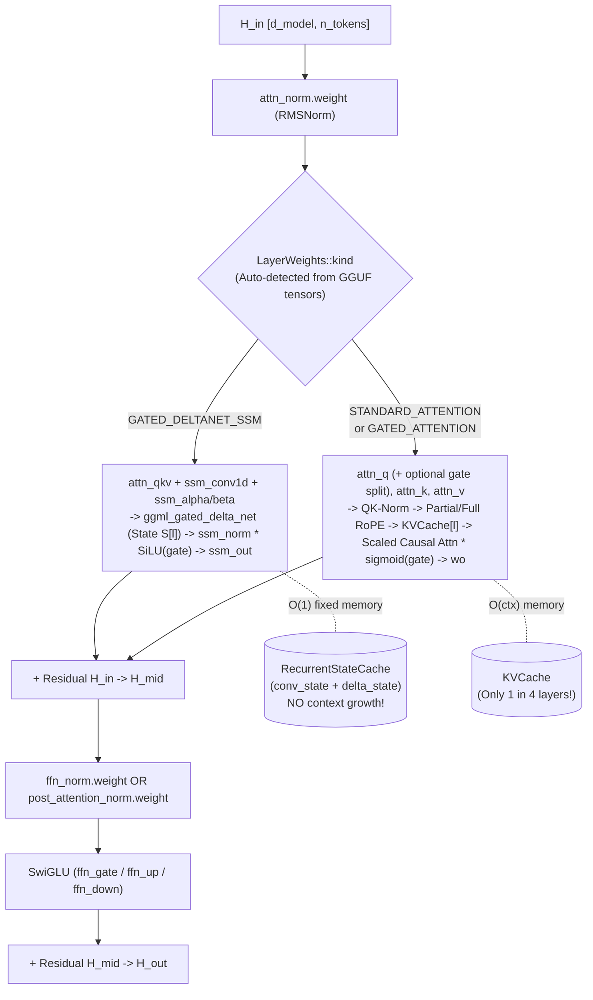

# OpenGP Architecture Plan: Hybrid SSM & Gated Attention (`feat/ssm-hybrid`)

> **Target Models:** `Qwen3.6-12B-IQ-Q8_0.gguf`, `Qwen3.8-27B-Uncensored-Q8_0.gguf` (`general.architecture = qwen35`), and future Mamba / Hybrid Linear-Attention architectures.

---

## 1. Why Existing Phase 2 Rejected `Qwen3.6-12B` & `Qwen3.8-27B`

Standard Transformers (`llama`, `qwen3`, `stories15M`) repeat the **exact same block layout** across every layer (`attn_q`, `attn_k`, `attn_v`, `attn_output`, `ffn_norm`).

By inspecting `Qwen3.6-12B-IQ-Q8_0.gguf` (`block_count = 24`) and `Qwen3.8-27B-Uncensored-Q8_0.gguf` (`block_count = 65`) directly, both use the **`qwen35` Hybrid Architecture** (`qwen35.full_attention_interval = 4`):

### 1.1 Inspected GGUF Hyperparameters (`Qwen3.6-12B-IQ-Q8_0.gguf`)

| GGUF Key | Value | Meaning |
| :--- | :--- | :--- |
| `general.architecture` | `qwen35` | Hybrid Gated DeltaNet + Full Gated Attention |
| `qwen35.block_count` | `24` | 18 SSM layers + 6 Full Gated Attention layers |
| `qwen35.embedding_length` | `5120` | `d_model = 5120` |
| `qwen35.feed_forward_length` | `17408` | `d_ff = 17408` (SwiGLU) |
| `qwen35.full_attention_interval` | `4` | Layers `0,1,2` = SSM; Layer `3` = Full Attention; repeats every 4 blocks |
| `qwen35.attention.head_count` / `head_count_kv` | `24` / `4` | Full Attention GQA (`6:1` ratio), `d_head = 256` |
| `qwen35.rope.dimension_count` | `64` | Partial RoPE (`64` out of `256` dims rotated), `freq_base = 10000000.0` |
| `qwen35.ssm.conv_kernel` | `4` | Causal 1D depthwise convolution window (`K_conv = 4`) |
| `qwen35.ssm.state_size` | `128` | DeltaNet key/value head dim (`d_state = 128`) |
| `qwen35.ssm.group_count` | `16` | Q/K head groups (`n_ssm_groups = 16`) |
| `qwen35.ssm.time_step_rank` | `48` | Value/V-head count (`n_ssm_heads = 48`, `48 × 128 = 6144 = inner_size`) |
| `qwen35.ssm.inner_size` | `6144` | DeltaNet value projection width (`48 × 128`) |

### 1.2 Two Distinct Block Types Inside One Model

1. **Gated DeltaNet SSM Blocks (`blk.0`, `blk.1`, `blk.2`, `blk.4`, ...):**
   - `blk.l.attn_norm.weight` (`[5120]`)
   - `blk.l.attn_qkv.weight` (`[5120, 10240]`) — fused $Q + K + V$ projection (`2048 + 2048 + 6144 = 10240`, i.e. $16\times128 + 16\times128 + 48\times128$)
   - `blk.l.attn_gate.weight` (`[5120, 6144]`) — output gate $Z$
   - `blk.l.ssm_conv1d.weight` (`[4, 10240]`) — causal temporal conv1d weights
   - `blk.l.ssm_alpha.weight` (`[5120, 48]`), `blk.l.ssm_beta.weight` (`[5120, 48]`)
   - `blk.l.ssm_a` (`[48]`), `blk.l.ssm_dt.bias` (`[48]`) — decay parameterization
   - `blk.l.ssm_norm.weight` (`[128]`) — per-head RMSNorm inside SSM output
   - `blk.l.ssm_out.weight` (`[6144, 5120]`) — final SSM projection
   - `blk.l.post_attention_norm.weight` (`[5120]`) + SwiGLU `ffn_gate/up/down`

2. **Gated Full Attention Blocks (`blk.3`, `blk.7`, `blk.11`, ...):**
   - `blk.l.attn_norm.weight` (`[5120]`)
   - `blk.l.attn_q.weight` (`[5120, 12288]`) — **Fused `Q` + Attention Output Gate (`2 × 24 × 256 = 12288`)!** Note: `ne[1]` is `2×` `n_heads * d_head_k`!
   - `blk.l.attn_k.weight` (`[5120, 1024]`), `blk.l.attn_v.weight` (`[5120, 1024]`) (`4 × 256 = 1024`)
   - `blk.l.attn_q_norm.weight` (`[256]`), `blk.l.attn_k_norm.weight` (`[256]`)
   - `blk.l.attn_output.weight` (`[6144, 5120]`)
   - `blk.l.post_attention_norm.weight` (`[5120]`) + SwiGLU `ffn_gate/up/down`

---

## 2. Core Architectural Design

### 2.1 High-Level Hybrid Pipeline



---

## 3. Component-by-Component Implementation Plan

### Step 1: Extend `ModelConfig` (`include/reasoner/model_config.h`, `src/reasoner/model_config.cpp`)
Add zero-hardcoding SSM / Hybrid fields read from `<arch>.*`:
- `int32_t ssm_conv_kernel = 0;` (`<arch>.ssm.conv_kernel`)
- `int32_t ssm_state_size = 0;` (`<arch>.ssm.state_size`)
- `int32_t ssm_group_count = 0;` (`<arch>.ssm.group_count`)
- `int32_t ssm_time_step_rank = 0;` (`<arch>.ssm.time_step_rank`)
- `int32_t ssm_inner_size = 0;` (`<arch>.ssm.inner_size`)
- `int32_t full_attention_interval = 0;` (`<arch>.full_attention_interval`)
- Extend `arch_uses_neox_rope()` to include `"qwen35"` (already falls back cleanly or check `qwen35.rope.*`).
- Also note: filter out `<arch>.nextn_predict_layers` MTP extra block (`blk.24` / `blk.64` if `nextn_predict_layers > 0`) or handle dynamically if `block_count` includes MTP layers! *(Check `blk.l.*` presence: in `Qwen3.6-12B`, `block_count=24` -> `blk.0..23`.)*

---

### Step 2: Data-Driven `LayerKind` & `WeightStore` (`include/reasoner/weight_store.h`, `src/reasoner/weight_store.cpp`)
Instead of switching on architecture names, detect each layer's block type **strictly from its GGUF tensors**:
- Define:
  ```cpp
  enum class LayerKind {
      STANDARD_ATTENTION,
      GATED_ATTENTION,
      GATED_DELTANET_SSM
  };
  ```
- Resolution per layer `l`:
  - `ffn_norm`: check `blk.l.ffn_norm.weight`, **fallback** to `blk.l.post_attention_norm.weight`.
  - If `blk.l.ssm_out.weight` exists $\rightarrow$ `LayerKind::GATED_DELTANET_SSM`:
    - Load `attn_qkv`, `attn_gate`, `ssm_conv1d`, `ssm_alpha`, `ssm_beta`, `ssm_a`, `ssm_dt_bias`, `ssm_norm`, `ssm_out`.
  - Else $\rightarrow$ Attention layer (`blk.l.attn_q` exists):
    - Inspect `wq->ne[1]`: if `wq->ne[1] == 2 * config.n_heads * config.d_head_k`, mark `LayerKind::GATED_ATTENTION` (fused Query + Output Gate!); otherwise `LayerKind::STANDARD_ATTENTION`.
- Preserve 100% of existing GPU-resident + single-layer `stage_buf_` streaming logic uniformly across all three `LayerKind` variants via a single expanded tensor visitor!

---

### Step 3: Split Memory Architecture (`KVCache` + New `RecurrentStateCache`)
Because only `1` out of every `full_attention_interval` layers (`6 / 24` layers in `Qwen3.6-12B`) uses Attention, we save **4× KV VRAM** by splitting state caches cleanly:

1. **Sparse `KVCache` (`kv_cache.h/.cpp`):**
   - Accept an owned layer-kind map or allocate `k_layers_[local_l]` / `v_layers_[local_l]` **only** for Attention layers (`LayerKind != GATED_DELTANET_SSM`), leaving `nullptr` slots for SSM layers!
   - Compute `bytes_per_token()` across only the Attention layers (for `Qwen3.6-12B`: `6` attn layers × `2 × 4 × 256 × 2 B = 24 KB/token` vs `96 KB/token` if wasted on all 24 layers!).

2. **New `RecurrentStateCache` (`include/reasoner/recurrent_cache.h`, `src/reasoner/recurrent_cache.cpp`):**
   - Allocates fixed $O(1)$ tensors on `backend_` **only** for `GATED_DELTANET_SSM` layers (independent of `--ctx-size`!):
     - `conv_state[local_l]`: `[ssm_conv_in_dim, conv_kernel - 1]` (`F32`, for `Qwen3.6-12B`: `10240 × 3 × 4 B = 120 KB/layer`)
     - `ssm_state[local_l]`: `[d_state * d_state, n_ssm_heads]` or `[d_state, d_state, n_ssm_heads]` (`F32`, for `Qwen3.6-12B`: `128 × 128 × 48 × 4 B = 3.0 MB/layer`)
   - Total recurrent state VRAM for ALL 18 SSM layers of `Qwen3.6-12B` = **only `~56 MB` fixed**, regardless of whether context is 512 or 262,144 tokens!
   - Expose `reset()` (zero-fills state buffers via `ggml_backend_tensor_memset(..., 0, ...)`) for clean new-turn / `-i` interactive restarts, and `init()` / `get_conv_state()` / `get_ssm_state()`.

---

### Step 4: Dual GGML Computation Graphs (`layer_graph.h/.cpp`)

Already verified present in `vendor/ggml/include/ggml.h` (lines 842, 986, 1045, 1238, 2295, 2424) and vendored in both `ggml-cpu`, `ggml-cuda`, and `ggml-metal`:

1. **`build_gated_deltanet_graph(...)` (for `LayerKind::GATED_DELTANET_SSM`):**
   - `cur = rms_norm_weighted(ctx, H_in, w.attn_norm)`
   - **QKV + Causal Conv1D:**
     - `qkv = ggml_mul_mat(ctx, w.attn_qkv, cur)` (`[10240, n_tokens]`)
     - Prepend/concat rolling `conv_state` (`[10240, conv_kernel - 1]`) with `qkv` $\rightarrow$ `conv_in` (`[10240, conv_kernel - 1 + n_tokens]`)
     - Update new rolling `conv_state` slice (`last conv_kernel - 1 columns`) back into `RecurrentStateCache` via `ggml_cpy`
     - `qkv_conv = ggml_silu(ctx, ggml_ssm_conv(ctx, conv_in, w.ssm_conv1d))`
     - Split `qkv_conv` along dim 0 via `ggml_view_2d`: `Q` (`[2048, n]`), `K` (`[2048, n]`), `V` (`[6144, n]`)
   - **L2 Normalization & Head Reshaping:**
     - Reshape `Q`, `K` to `[d_state, n_groups, n_tokens]`, `V` to `[d_state, n_ssm_heads, n_tokens]`
     - `Q = ggml_l2_norm(ctx, Q, eps)` (normalized & scaled by `1 / sqrt(d_state)`)
     - `K = ggml_l2_norm(ctx, K, eps)`
   - **Decay Gate $g$ and Update Rate $\beta$:**
     - `beta = ggml_sigmoid(ctx, ggml_mul_mat(ctx, w.ssm_beta, cur))` (`[n_ssm_heads, n_tokens]`)
     - `alpha = ggml_mul_mat(ctx, w.ssm_alpha, cur)`
     - `g = ggml_mul(ctx, ggml_softplus(ctx, ggml_add(ctx, alpha, w.ssm_dt_bias)), w.ssm_a)` (where `ssm_a` stores $-\exp(A_{\log})$ or verified sign in GGUF)
   - **GGML Native DeltaNet Kernel:**
     - `res = ggml_gated_delta_net(ctx, Q, K, V, g, beta, ssm_state_tensor, ...)`
     - Split `res` output + updated `new_state` view (`ggml_view_1d` / `ggml_view_2d` per GGML convention — inspect `ggml-cuda/gated_delta_net.cu` exact tensor layout during implementation!), copy `new_state` back into `RecurrentStateCache`
   - **Gated Norm Output Projection + SwiGLU FFN:**
     - `out = ggml_mul(ctx, rms_norm_weighted(ctx, ssm_out, w.ssm_norm), ggml_silu(ctx, gate_proj))`
     - `H_mid = H_in + ggml_mul_mat(ctx, w.ssm_out, out)`
     - Post-Attn RMSNorm + SwiGLU + Residual 2 (`H_out`).

2. **`build_layer_graph(...)` Extension for `LayerKind::GATED_ATTENTION`:**
   - When `LayerKind::GATED_ATTENTION` (e.g. `blk.3` in `Qwen3.6-12B`):
     - `QG = ggml_mul_mat(ctx, w.wq, cur)` (`[2 * n_heads * d_head_k, n_tokens]`)
     - Reshape `QG` to `[d_head_k, 2, n_heads, n_tokens]` (check interleaved vs split `[Q, Gate]` layout directly against HuggingFace/llama.cpp `qwen3next`/`qwen35` converter!).
     - Run normal `QK-Norm` + `RoPE` (`rope_dim = 64` partial RoPE on `d_head = 256`!) + Causal GQA Attention on `Q, K, V`.
     - Multiply attention output before `W_o` by `ggml_sigmoid(ctx, Gate)`:
       `KQV_gated = ggml_mul(ctx, KQV_merged, ggml_sigmoid(ctx, Gate))`
     - Project through `w.wo` + Residual 1 + `post_attention_norm` + SwiGLU + Residual 2.

---

### Step 5: `ReasoningEngine` & Distributed `LayerRange` Compatibility
- In `ReasoningEngine::initialize()`:
  - Allocate `RecurrentStateCache` ($O(1)$ size) alongside `KVCache` **before** computing remaining VRAM for `WeightStore`.
  - Keep `LayerRange` (`[start .. end)`) working seamlessly — distributed nodes only allocate `KVCache` for attention layers inside their owned slice and `RecurrentStateCache` for SSM layers inside their owned slice!
- In `ReasoningEngine::reset_kv_cache()`:
  - Also calls `recurrent_cache_.reset()` so SSM rolling state starts clean on a new conversation.

---

## 4. Verification Strategy (Once Implemented on `feat/ssm-hybrid`)

1. **Build Verification:** `make` compiles cleanly with both CUDA GPU and CPU SIMD backends (`OPENGP_HAS_CUDA=1`, Metal `if(APPLE)` intact).
2. **Forward Pass Integrity (`opengp_reasoner`):**
   - `./build/opengp_reasoner --model models/Qwen3.6-12B-IQ-Q8_0.gguf --prompt "What is 2+2?" --verify-equivalence`
   - Verify `[KV Cache]` allocates only for the 6 Attention layers (`24.0 KB/tok`), `[SSM State]` allocates fixed `~56 MB`, zero `NaN`/`Inf`, and **Prefill vs. Sequential Decode Cosine Similarity `> 0.999`** (proving `conv_state` rolling buffer + `gated_delta_net` state update + gated attention match mathematically!).
3. **End-to-End Inference (`opengp_infer`):**
   - `./build/opengp_infer --model models/Qwen3.6-12B-IQ-Q8_0.gguf --prompt "What is the capital of France?" --temp 0 --max-tokens 64`
   - Verify coherent response naming **Paris**!
4. **Zero-Regression Check:** Re-run `stories15M.gguf`, `baronllm-llama3.1-v1-q6_k.gguf`, and `Qwen3-8B-Q8_0.gguf` to confirm existing dense Transformers remain untouched and fast.
