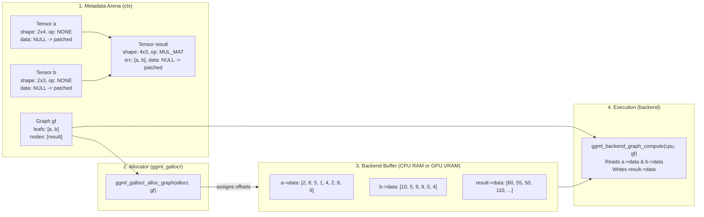

# How `ggml` Works: `context`, `gf`, `backend`, and `data`

This guide explains the four core pieces of `ggml` using the matrix multiplication example in [`matmul.cpp`](./matmul.cpp).

---

## Quick Mental Model

| Concept | Type | Analogy | What it holds |
| :--- | :--- | :--- | :--- |
| **`ctx`** | `struct ggml_context *` | **Blueprint / Arena** | The memory pool holding `ggml_tensor` headers and `ggml_cgraph` structs (metadata). |
| **`gf`** | `struct ggml_cgraph *` | **Recipe / Execution Plan** | Ordered list of input tensors (`leafs`) and operations (`nodes`) to run. |
| **`backend`** | `ggml_backend_t` | **Worker / Hardware Driver** | The CPU or GPU engine that allocates buffers and executes kernels. |
| **`data`** | `void *` inside `ggml_backend_buffer` | **Warehouse / Raw Numbers** | The actual float/quantized arrays in CPU RAM or GPU VRAM. |

---

## End-to-End Flow Illustration



---

## Step-by-Step Walkthrough (from `matmul.cpp`)

### 1. `backend` — The Compute Device
```cpp
ggml_backend_load_all();
ggml_backend_t cpu = ggml_backend_init_by_type(GGML_BACKEND_DEVICE_TYPE_CPU, nullptr);
```
* `backend` represents **where** the computation runs (here, the CPU; in a GPU setup, CUDA/Vulkan/Metal).
* It knows how to allocate device memory (`ggml_backend_get_default_buffer_type(cpu)`), copy data to/from the device, and execute `ggml_cgraph` operations.

---

### 2. `ctx` (`ggml_context`) — The Metadata Arena
```cpp
const size_t ctx_size = ggml_tensor_overhead() * GGML_DEFAULT_GRAPH_SIZE + ggml_graph_overhead();
std::vector<uint8_t> ctx_buf(ctx_size);

struct ggml_init_params params = {
    /*.mem_size   =*/ ctx_size,
    /*.mem_buffer =*/ ctx_buf.data(),
    /*.no_alloc   =*/ true,
};
struct ggml_context * ctx = ggml_init(params);
```
* `ctx` is a bump allocator over `ctx_buf`.
* Because `no_alloc = true`, `ctx` **only** stores lightweight structs (`ggml_tensor` headers and `ggml_cgraph`), **not** the actual matrix numbers.
* When you define tensors:
  ```cpp
  struct ggml_tensor * a      = ggml_new_tensor_2d(ctx, GGML_TYPE_F32, cols_a, rows_a);
  struct ggml_tensor * b      = ggml_new_tensor_2d(ctx, GGML_TYPE_F32, cols_b, rows_b);
  struct ggml_tensor * result = ggml_mul_mat(ctx, a, b);
  ```
  Each call carves a `struct ggml_tensor` out of `ctx_buf`:
  * `a` and `b` have `op = GGML_OP_NONE` and `data = NULL`.
  * `result` has `op = GGML_OP_MUL_MAT`, `src[0] = a`, `src[1] = b`, and `data = NULL`.
  * **No math has run yet.**

---

### 3. `gf` (`ggml_cgraph`) — The Computation Graph
```cpp
struct ggml_cgraph * gf = ggml_new_graph(ctx);
ggml_build_forward_expand(gf, result);
```
* `ggml_new_graph(ctx)` allocates the `ggml_cgraph` struct inside `ctx`.
* `ggml_build_forward_expand(gf, result)` walks backward from `result` through `src[]` pointers and records the execution DAG in topological order:
  * `gf->leafs = [a, b]` (inputs/weights)
  * `gf->nodes = [result]` (operations to compute)

---

### 4. `data` & `ggml_backend_buffer` — Where the Numbers Live
```cpp
ggml_gallocr_t allocr = ggml_gallocr_new(ggml_backend_get_default_buffer_type(cpu));
ggml_gallocr_alloc_graph(allocr, gf);
```
* `ggml_gallocr_alloc_graph` asks `cpu`'s buffer type for a `ggml_backend_buffer` large enough for all tensors in `gf`.
* It then **patches** every tensor in `gf` so `tensor->buffer` points to that backend buffer and `tensor->data` points to its assigned byte offset inside that buffer.

```text
ctx_buf (metadata only)                ggml_backend_buffer (CPU RAM or GPU VRAM)
┌───────────────────────────┐          ┌───────────────────────────────────────┐
│ struct ggml_tensor a      │          │ offset 0:                             │
│   .op   = NONE            │          │   [ 2.0, 8.0, 5.0, 1.0, ... ]         │
│   .data ──────────────────┼─────────►│                                       │
├───────────────────────────┤          ├───────────────────────────────────────┤
│ struct ggml_tensor b      │          │ offset 32:                            │
│   .op   = NONE            │          │   [ 10.0, 5.0, 9.0, 9.0, 5.0, 4.0 ]   │
│   .data ──────────────────┼─────────►│                                       │
├───────────────────────────┤          ├───────────────────────────────────────┤
│ struct ggml_tensor result │          │ offset 64:                            │
│   .op   = MUL_MAT         │          │   (empty until compute runs)          │
│   .src  = [ &a, &b ]      │          │   -> [ 60.0, 55.0, 50.0, 110.0, ... ] │
│   .data ──────────────────┼─────────►│                                       │
└───────────────────────────┘          └───────────────────────────────────────┘
```

Next, we upload the raw input numbers into `a->data` and `b->data`:
```cpp
ggml_backend_tensor_set(a, mat_a, 0, ggml_nbytes(a));
ggml_backend_tensor_set(b, mat_b, 0, ggml_nbytes(b));
```

---

### 5. Execution — Putting It All Together
```cpp
ggml_backend_graph_compute(cpu, gf);
```
* Notice **`ctx` is not passed** to `ggml_backend_graph_compute`.
* `cpu` (the `backend`) loops through `gf->nodes`:
  1. Sees `result` (`op = GGML_OP_MUL_MAT`).
  2. Reads input data via `result->src[0]->data` (`a->data`) and `result->src[1]->data` (`b->data`).
  3. Computes `A * B^T` and writes the output into `result->data`.
* Finally, we copy the result back to a host `std::vector<float>`:
  ```cpp
  ggml_backend_tensor_get(result, out.data(), 0, ggml_nbytes(result));
  ```

---

## Why This Design Matters for Distributed / Volunteer GPUs

1. **Device-Independent Graphs:** `ctx` and `gf` are pure metadata—you build the exact same graph whether `backend` is a CPU, an NVIDIA CUDA GPU, or an AMD/Intel Vulkan GPU.
2. **Zero Runtime Allocations:** `ggml_gallocr` pre-plans all buffer offsets before `ggml_backend_graph_compute` runs.
3. **Clean Separation of Concerns:** Metadata (`ctx`), execution plan (`gf`), hardware driver (`backend`), and tensor memory (`data`) are completely decoupled.
